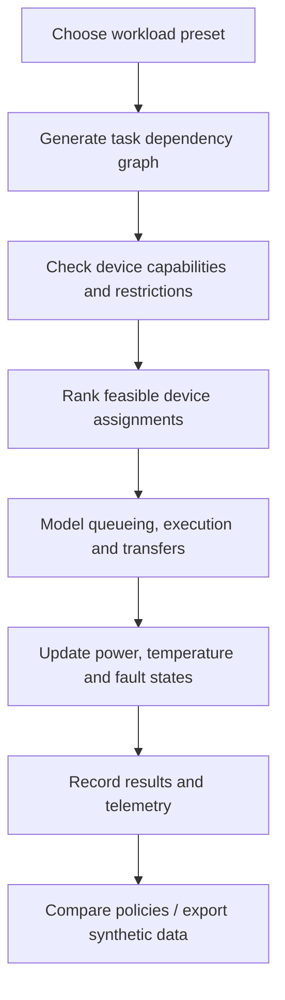

# HYPERION-20

**An interactive, offline simulation of a hypothetical heterogeneous supercomputer coordinating 20 processor classes.**


[](LICENSE)

[**Launch the simulator**](HYPERION-20_Standalone_Simulator.html) · [**Download the HTML**](https://raw.githubusercontent.com/kai9987kai/HYPERION-20/main/HYPERION-20_Standalone_Simulator.html) · [**Read the research paper**](Hyperion20_Paper.pdf) · [**Community**](https://github.com/kai9987kai/HYPERION-20/community)

> [!IMPORTANT]
> **This is an engineering *simulation*, not a physical processor emulator or a working supercomputer.** All 20 devices are software models executed in JavaScript on the host computer. Performance, power, temperature, networking, failure and scheduling values are **illustrative synthetic parameters**, not measurements of NVIDIA, Intel, Cerebras, IBM, Groq, Google or other hardware. The quantum and biological examples do not execute quantum programs or living-cell experiments.

## Overview

HYPERION-20 explores a central systems-engineering question:

**How could a scheduler coordinate conventional, specialised, probabilistic and experimental computing resources without assuming that every processor executes the same kind of workload?**

The simulator presents a fictional computing facility with 20 computational service classes, a virtual execution fabric, dependency-aware jobs, device-specific operation compatibility and selectable scheduling strategies. The application is intended for education, architectural prototyping, experimentation and discussion of heterogeneous computing.

The whole interface is delivered as **one self-contained HTML file** with embedded CSS and JavaScript. There is no installation, build process, backend server, account or network connection required.

## Quick start

### Option A — download one file

1. Open [`HYPERION-20_Standalone_Simulator.html`](HYPERION-20_Standalone_Simulator.html).
2. Select **Download raw file** (or download it from the [raw link](https://raw.githubusercontent.com/kai9987kai/HYPERION-20/main/HYPERION-20_Standalone_Simulator.html)).
3. Open the downloaded `.html` file in a modern desktop browser such as Chrome, Edge or Firefox.
4. Select a workload preset and click **Dispatch workload**.
5. Watch the virtual fabric, execution timeline, telemetry graphs and event trace.

### Option B — clone the repository

```bash
git clone https://github.com/kai9987kai/HYPERION-20.git
cd HYPERION-20
```

Open `HYPERION-20_Standalone_Simulator.html` in your browser. On Windows you can double-click the file in File Explorer. Nothing needs to be installed beyond a modern browser.

**Runtime:** HTML5, CSS3 and vanilla JavaScript. **Execution:** client-side and offline. **Hardware:** no special GPU, NPU, FPGA, QPU or biological hardware is needed.

## Features

- **20 virtual processor classes** with independent capabilities, concurrent execution lanes, modelled performance, memory, electrical power and thermal behaviour.
- **Dependency-aware workflow engine** with job submission, task states, device selection, queues and completion events.
- **Five routing policies:** balanced, lowest predicted latency, throughput-oriented, energy-conscious and static preferred-backend routing.
- **Nine workload presets**, including a diagnostic that visits all 20 processor models.
- **Simulation controls:** pause/resume, step forward by one virtual second, reset and change virtual-time speed from 1× to 32×.
- **Hardware experimentation:** adjust cooling effectiveness; allow or restrict research-only processors; optionally model random faults; inject an 18-second fault; and restore devices.
- **Live observability:** facility metrics, device inspector, execution timeline, power/temperature/utilisation telemetry and event trace.
- **Policy comparison lab:** compare scheduling approaches under the simulator's assumptions.
- **Per-device micro-model demonstrations:** small educational computations illustrating the functional idea of a selected processor.
- **Exportable data:** download synthetic telemetry as CSV or an execution snapshot as JSON.

## The 20 processor classes

| # | Processor | Simulated role |
|---:|---|---|
| 01 | **CPU** — Central Processing Unit | General control, serial work, scheduling and fallback |
| 02 | **GPU** — Graphics Processing Unit | Rendering and highly parallel numerical work |
| 03 | **PPU** — Physics Processing Unit | Physics simulation and collision workloads |
| 04 | **APU** — Accelerated Processing Unit | Integrated CPU/GPU-style processing |
| 05 | **SPU** — Sound Processing Unit | Audio and signal-processing tasks |
| 06 | **NPU** — Neural Processing Unit | Efficient neural-network inference |
| 07 | **TPU** — Tensor Processing Unit | Tensor algebra and machine-learning kernels |
| 08 | **LPU** — Language Processing Unit | Language-model inference tasks |
| 09 | **MCU** — Microcontroller Unit | Embedded control and thermal management |
| 10 | **ISP** — Image Signal Processor | Camera and image preprocessing |
| 11 | **Security Processor** | Trusted control and access-policy operations |
| 12 | **ASIC** — Application-Specific Integrated Circuit | Fixed-purpose processing |
| 13 | **FPGA** — Field-Programmable Gate Array | Reconfigurable data pipelines |
| 14 | **DPU** — Data Processing Unit | Networking, packet processing and infrastructure work |
| 15 | **WSE** — Wafer-Scale Engine | Wafer-scale AI computation |
| 16 | **Neuromorphic Processor** | Event-driven and spiking-neuron workloads |
| 17 | **Photonic Processor** | Idealised optical computation |
| 18 | **QPU** — Quantum Processing Unit | Simplified quantum measurement experiments |
| 19 | **TSU** — Thermodynamic Sampling Unit | Probabilistic sampling experiments |
| 20 | **BPU** — Biological Processing Unit | Synthetic biological-neuron proxy experiments |

The names identify **functional service categories**, not 20 independent physical instruction-set architectures. Real implementations overlap: an APU can integrate CPUs and GPUs; WSEs are specialised ASICs; physics may run as GPU code; and some experimental backends are only remotely accessible or laboratory-based.

## Workload presets

Select a preset under **Experiment control**:

| Preset | Purpose |
|---|---|
| Multimodal AI assistant | Simulate capture, signal preprocessing, embeddings, inference and secure delivery |
| AI model training | Explore accelerator-oriented training and data processing |
| Interactive 3D simulation | Explore rendering, physics and audio execution |
| Robotics sensor fusion | Route sensing and control-related work |
| Quantum + thermodynamic study | Explore research-only quantum and stochastic task types |
| Bio-neuromorphic research | Explore specialised event-driven and biological proxy tasks |
| Custom ASIC and FPGA pipeline | Exercise fixed-function and reconfigurable processing |
| Integrated edge multimedia | Model integrated multimedia workloads |
| 20-processor diagnostic sweep | Submit a diagnostic task for every virtual processor class |

The control panel also offers job submission quantities of **1, 3, 8 or 16 concurrent jobs**.

### Recommended first experiment

1. Choose **20-processor diagnostic sweep**.
2. Leave **Allow research backends** enabled.
3. Press **Dispatch workload**.
4. Select individual processor tiles to inspect their state and configuration.
5. Switch to **Lowest predicted latency**, **Energy-conscious** or **Static · preferred backend** and compare behaviour.
6. Use **Compare scheduling policies**, then export the results.

For a fault-handling demonstration, submit a workload and use **Inject 18s fault** or enable **Model random device faults**. If a specialised research task has no compatible alternative backend, it may remain blocked rather than being silently substituted by a semantically incompatible processor.

## Scheduling and simulated physics

HYPERION models a **virtual execution environment**, not actual semiconductor timing. Its engine includes dependency-aware task dispatch, device capacity, estimated execution duration, setup and data movement, queue contention, simple energy accounting, thermal dynamics and fault availability.

The available scheduler policies are:

| Policy | Intended behaviour |
|---|---|
| **Balanced** | Trade predicted latency, energy and contention |
| **Lowest predicted latency** | Prefer the lowest estimated completion time |
| **Throughput** | Increase avoidance of busy resources |
| **Energy-conscious** | Prefer lower modelled energy use |
| **Static** | Prefer predefined backends instead of adaptive selection |

The simulator can be used to reason about the effects of data-transfer overhead, resource saturation and thermal throttling. Those effects are calculated from simplified equations and invented device profile parameters. Their outputs **must not** be used to estimate actual procurement costs, hardware performance or datacentre power requirements.

### Conceptual control flow



## Micro-model probes

The **Model execution probe** runs a small JavaScript demonstration for the selected processor. Examples include matrix multiplication, INT8-style dot products, audio RMS, Bayer demosaicing, finite-state control, bit counting, a leaky integrate-and-fire neuron, optical interference, classical random sampling of a quantum-like measurement, and a synthetic biological spike proxy.

These examples illustrate mathematical or operational ideas only:

- **QPU:** a classical random-number generator produces measurement-like outcomes; no qubits or quantum gates are implemented.
- **TSU:** JavaScript samples a selected probability distribution; no physical thermodynamic circuit is simulated.
- **BPU:** a synthetic noisy neuron proxy produces spikes; no living cells, microelectrode arrays or biological dynamics are used.
- **WSE / TPU / LPU:** toy computations demonstrate workload types, not instruction-accurate vendor hardware.
- **Security processor:** a policy analogue is shown; no real trusted execution environment is created.

## Repository contents

```text
HYPERION-20/
├── README.md
├── HYPERION-20_Standalone_Simulator.html
├── Hyperion20_Paper.pdf
├── LICENSE
├── SECURITY.md
└── CODE_OF_CONDUCT.md
```

- [**Standalone simulator**](HYPERION-20_Standalone_Simulator.html) — full HTML/CSS/JavaScript application.
- [**Research paper (PDF)**](Hyperion20_Paper.pdf) — architecture proposal, research context, scheduling formulation and evaluation plan.
- [**MIT licence**](LICENSE) — source distribution and reuse terms.
- [**Security policy**](SECURITY.md) and [**code of conduct**](CODE_OF_CONDUCT.md) — repository community files.

## Research status and limitations

**Current state:** a functional browser-based simulator and a conceptual research manuscript. It is **not** an integrated deployment of 20 physical processors.

The simulator does **not** offer cycle-accurate CPU/GPU emulation, actual vendor firmware, real model training on specialised accelerators, cryogenic quantum simulation, detailed optical circuit physics, biological tissue operation, validated power modelling or empirically calibrated performance predictions. Its policy comparisons are experiments **inside the same synthetic model**, not independent hardware benchmark results.

Meaningful validation would require published hardware measurements, comparable real workloads, identical acceptance criteria, transfer and queue-time measurement, uncertainty estimation and reproducible experiments.

See [the research paper](Hyperion20_Paper.pdf) for the proposed system architecture and experimental methodology.

## Development roadmap

Potential future work—not a promise that these capabilities already exist:

- [ ] Add configurable workload DAG editing and custom JSON import.
- [ ] Expose and document model parameters and calibration assumptions.
- [ ] Add seeded experiment export/import for repeatable studies.
- [ ] Compare modelled versus observed CPU/GPU timings.
- [ ] Expand memory hierarchy, interconnect and resource-contention models.
- [ ] Improve scenario-level accuracy metrics and statistical output validation.
- [ ] Add adapter interfaces for optional real hardware or hosted services.
- [ ] Build automated tests for scheduling, device compatibility and faults.
- [ ] Add accessibility checks and more detailed documentation.

## Contributing

Ideas, bug reports, documentation improvements and reproducible experiments are welcome.

To propose a change, use the repository's [Issues](https://github.com/kai9987kai/HYPERION-20/issues) or submit a [pull request](https://github.com/kai9987kai/HYPERION-20/pulls). For code contributions, describe the behaviour changed, the relevant workload and how you tested it. Any new performance claim should clearly state whether it is simulated, vendor-reported or measured.

Please follow the [Code of Conduct](CODE_OF_CONDUCT.md). For vulnerabilities, consult [SECURITY.md](SECURITY.md) and avoid publishing sensitive exploit details in public issues.

## Licence

HYPERION-20 is available under the **[MIT License](LICENSE)**.

Copyright © 2026 Kai Piper.

---

**HYPERION-20 — Twenty processor models. One experimental computing fabric. A transparent distinction between simulation and reality.**
